<div align="center">


# ChatGPT / Codex Auto Switch

**ChatGPT Accounts**: a multi-account manager for ChatGPT / Codex on macOS.<br>
Switches to the next available account when the usage limit is reached and resumes interrupted conversations; continues, pauses and configures Codex conversations from one table;<br>
tracks team subscriptions, member payments and limit-reset credits. The UI is available in English and Simplified Chinese.

[](#requirements)
[](#requirements)
[](App)
[](engine.py)
[](LICENSE)

[**⬇ Download**](../../releases/latest) · [Features](#features) · [Sessions](#sessions) · [Install](#install) · [FAQ](#faq) · [中文](README.md)

<picture>
  <source media="(prefers-color-scheme: dark)" srcset="docs/images/en/overview-dark.png">
  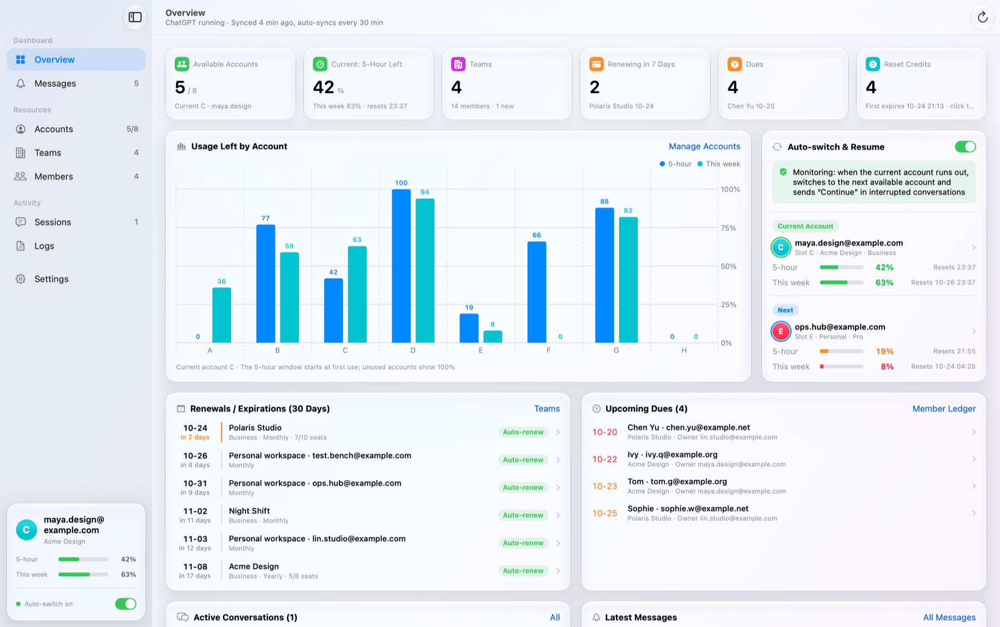
</picture>

</div>

> [!NOTE]
> This is an independent third-party tool. **It is not made by, affiliated with, or endorsed by OpenAI.**
> It relies on internal endpoints used by the ChatGPT desktop app, which may change at any time. Rotating
> several accounts may violate OpenAI's terms of use; evaluate the risk before use.
>
> The UI is available in English and Simplified Chinese (Settings → Language). All accounts, emails and team names in the screenshots are demo data generated by `scripts/demo.sh`.

## Overview

When a Codex account reaches its 5-hour usage limit, the reply stops. Continuing requires quitting ChatGPT, signing in to
another account, reopening the app and sending "continue" in the original conversation. With several accounts, the remaining
quota, team renewal dates and member payments also have to be tracked separately.

ChatGPT Accounts monitors usage in the background. When an account reaches its limit, it switches to the next available
account and resumes the interrupted conversations. Quota, team subscriptions and member payments for all accounts are shown in one place.

## Features

| Feature | Description |
|---|---|
| **Auto-switch and resume** | When the limit is reached, waits for the account's other running conversations to finish, switches to the next available account and resumes the interrupted conversations in the background, without bringing ChatGPT to the front |
| **Sessions** | Lists every Codex conversation with its status (running, possibly stuck, stopped at the limit) and account; continues or pauses one or several conversations in the background |
| **Model and speed** | Sets the model, reasoning effort (low to extra high) and speed (Standard / Fast) for one or several conversations, effective from the next turn; the options match ChatGPT's own menu |
| **Switching order** | Selects the next account alphabetically, by soonest reset or by most remaining quota; individual accounts can be excluded from rotation |
| **Quota monitoring** | Shows each account's remaining 5-hour and weekly quota and reset times; the current account is updated in near real time |
| **Continue after a turn ends** | When the model ends a turn on its own (not because of the limit), sends the resume prompt automatically, up to a per-conversation limit |
| **Start the clock** | Starts the 5-hour window of an unused account now; the background service can do this for each account in turn |
| **Reset credits** | Lists each account's (workspace's) free limit-reset credits and their expiry; using a credit requires confirmation |
| **Teams and subscriptions** | Renewal / expiry dates, seat usage, members and pending invites for every team workspace |
| **Member payments** | Monthly due dates based on each member's join date, overdue entries in red; marking a payment moves the due date to the next period |
| **English / 中文** | Switches the UI language in Settings and relaunches the app; earlier messages and logs are shown in the current language |
| **Notifications** | Renewals, expiries, failed payments, dues, new members and expiring credits, 3 days in advance, with system notifications |
| **Cloudflare fallback** | When Cloudflare blocks the team, subscription or member endpoints, requests are sent through the app's built-in WebKit |
| **Local storage** | No server and no data collection |

Other features:

- The overview chart shows an account's workspace, remaining quota and reset times on hover; the auto-switch card shows the current and the next account.
- The account context menu provides switch, refresh quota, use a reset credit, start the clock, copy email, rename and delete. The inspector shows subscription, seats, role, two-factor authentication and credits.
- When some accounts are excluded from rotation, the account table is split into "in rotation" and "skipped" groups.
- Members can be exported to CSV, and the last "paid" mark can be undone.
- Appearance (system / light / dark) and keep-on-top window option.
- After the background service restarts, it checks conversations that hit the limit in the last 30 minutes and switches or resumes as needed.
- Conversations paused from the Sessions page are marked "paused here" and skipped by auto-resume.
- Deactivated workspaces can be removed from the team list.
- The sidebar shows the current account with its 5-hour and weekly quota.

<table>
  <tr>
    <td>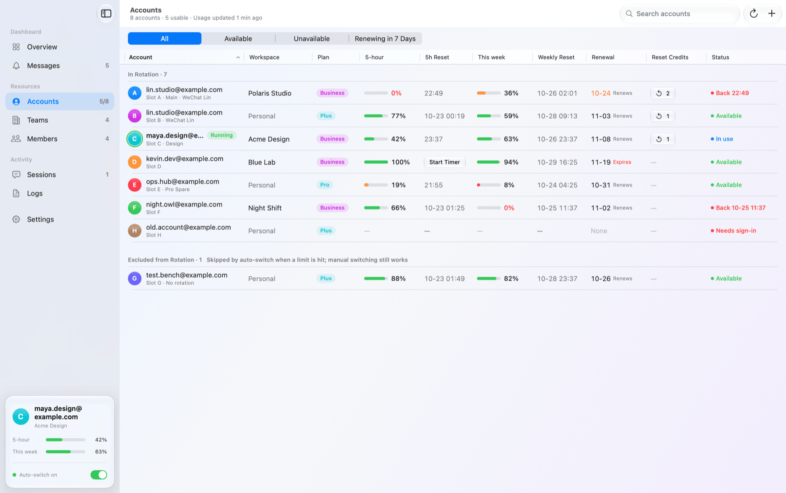</td>
    <td>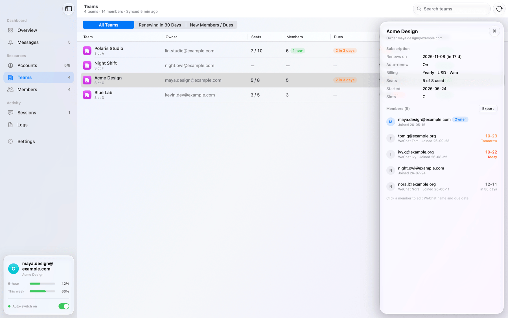</td>
  </tr>
  <tr>
    <td>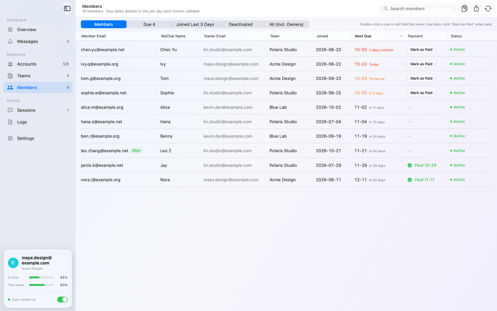</td>
    <td>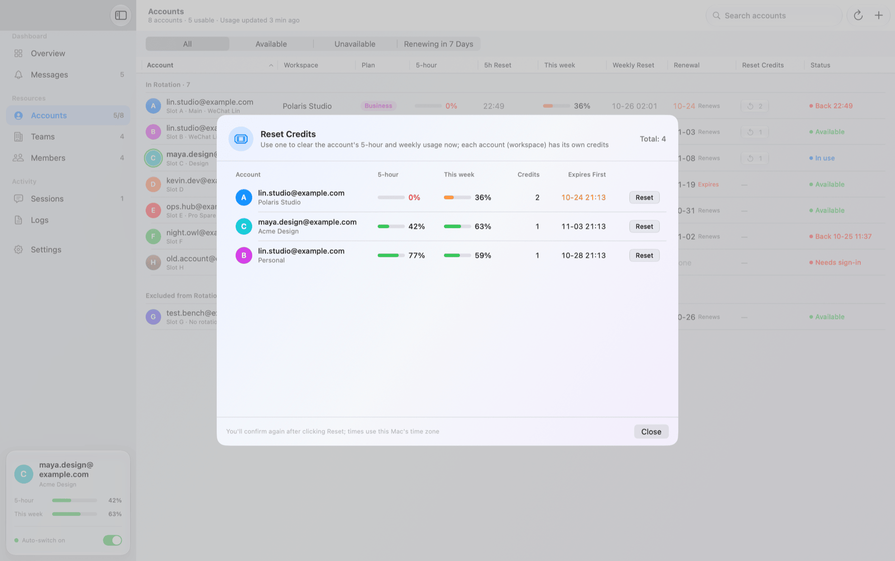</td>
  </tr>
  <tr>
    <td>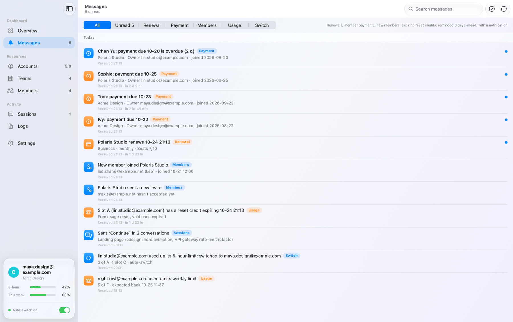</td>
    <td>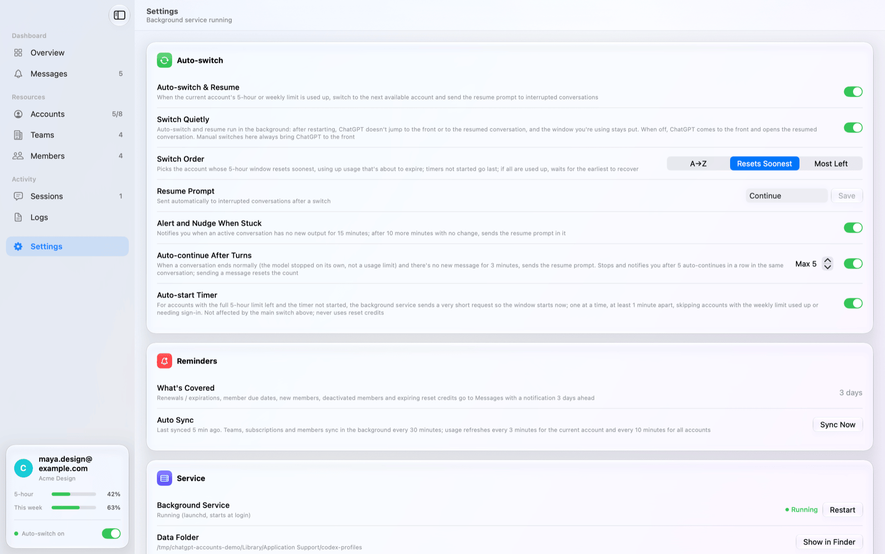</td>
  </tr>
  <tr>
    <td>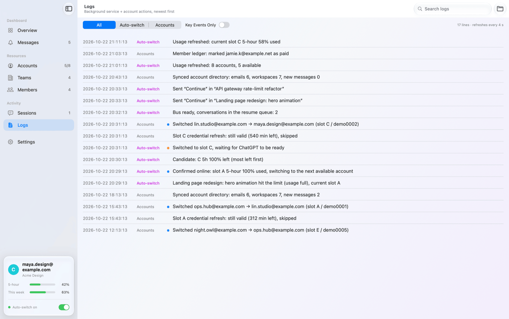</td>
    <td>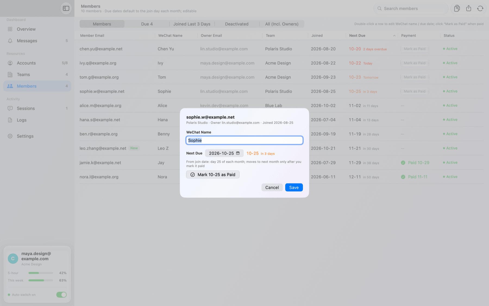</td>
  </tr>
</table>

## Sessions

The Sessions page lists Codex conversations from the last 48 hours with their status (running, possibly stuck, stopped at the
limit, paused here, stopped manually, done), account, project, sub-tasks, run time and last activity, sorted by last activity.
*Needs attention* shows only running, interrupted, paused and queued conversations. Conversations can be searched by title or project.
All actions run in the background and do not bring ChatGPT to the front.

- **Continue / pause**: idle conversations show *Continue*, running ones show *Pause*. Pausing is equivalent to ChatGPT's stop button;
  conversations paused here are marked and skipped by auto-resume.
- **Bulk actions**: select rows with the checkboxes (the header checkbox selects all). The header buttons continue, pause or adjust
  the model of the selected conversations, or of the whole list when nothing is selected.
- **Model, reasoning effort and speed**: the Model column shows the model and effort (⚡ for Fast). Clicking it opens the same menu as
  ChatGPT: model, effort (low / medium / high / extra high…) and speed (*Standard* / *Fast*, which uses more quota), with the current values checked.
- **Bulk adjust**: changes the model, effort and speed of all selected conversations at once; each setting can be left unchanged
  so that every conversation keeps its own value.

Changes take effect from the next turn and do not affect a turn in progress. A conversation that is not open in ChatGPT is opened
in the background briefly, and focus is returned afterwards.

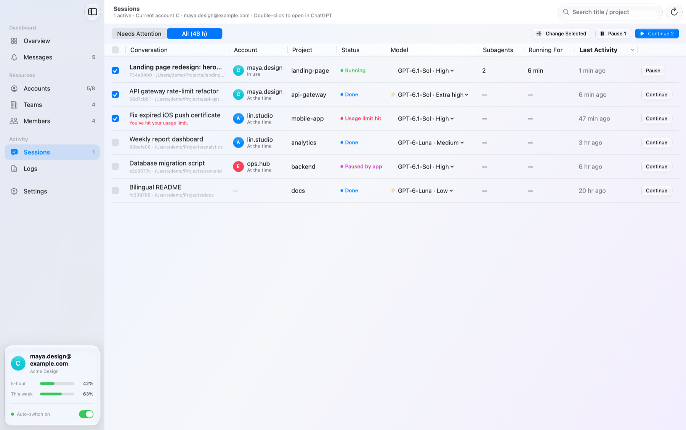

<table>
  <tr>
    <td width="50%">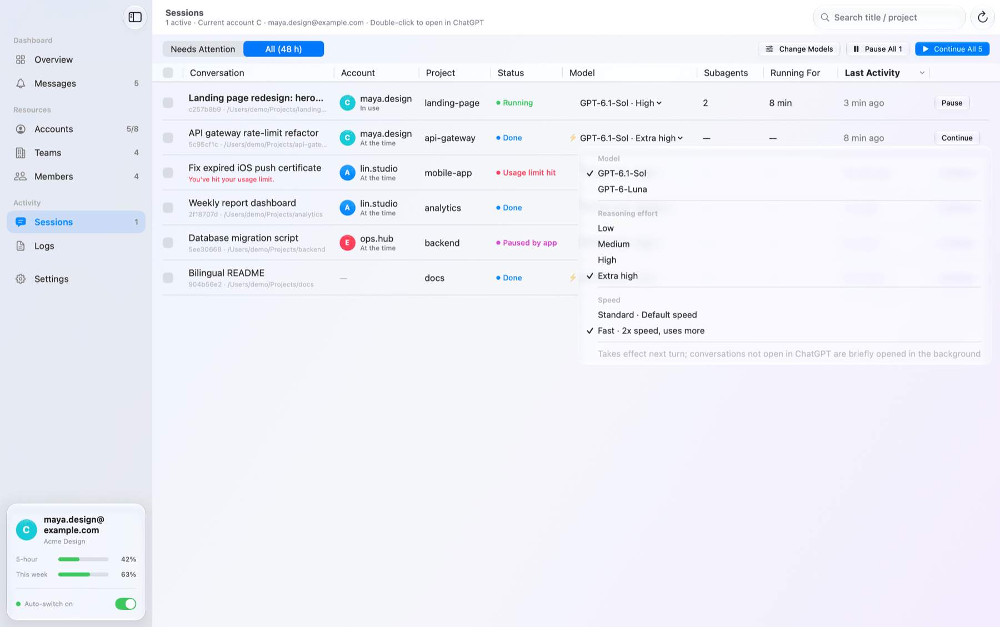</td>
    <td width="50%">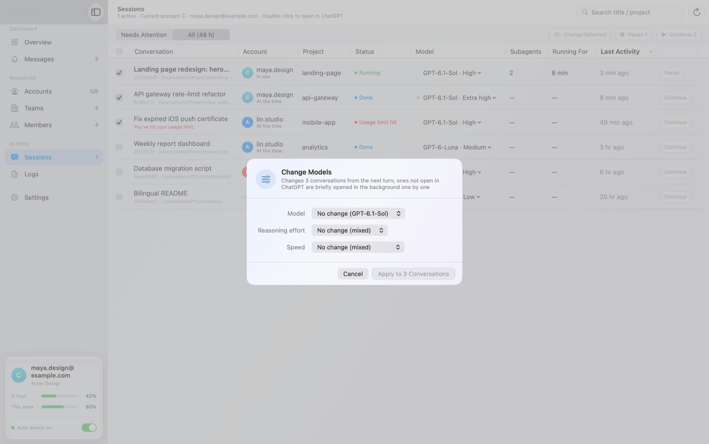</td>
  </tr>
  <tr>
    <td align="center">Model column menu</td>
    <td align="center">Bulk adjust</td>
  </tr>
</table>

## Requirements

- macOS 14 Sonoma or later on Apple silicon (M1 or newer). macOS 26 uses the Liquid Glass design; macOS 14 and 15 use the standard system style with the same features
- The [ChatGPT desktop app](https://chatgpt.com/download) (with Codex) installed in `/Applications`
- The system `/usr/bin/python3`. If the Command Line Tools are not installed, macOS prompts to install them on first launch

## Install

**Download:** download `ChatGPT-Accounts-x.y.zip` from [Releases](../../releases/latest), unzip it and move the app to Applications.
The build is not notarized. On first launch, open *System Settings → Privacy & Security* and click *Open Anyway*, or run:

```bash
xattr -dr com.apple.quarantine "/Applications/ChatGPT 账号.app"
```

**Build from source** (requires the Command Line Tools):

```bash
git clone https://github.com/autoswitch-accounts/chatgpt-codex-auto-switch.git && cd chatgpt-codex-auto-switch
```

```bash
./build.sh
```

**Demo mode** opens the app with demo data. It does not use the network, read real accounts or control ChatGPT:

```bash
scripts/demo.sh -AppleLanguages '(en)'
```

## Getting started

1. Click **＋** to add an account. A separate ChatGPT window opens; after you sign in and select a workspace, the credentials are
   saved to a slot (A, B, C…). Each account or team workspace uses its own slot. Adding an account quits ChatGPT first,
   so add accounts when no conversation is running.
2. The background service is installed automatically and starts at login. It monitors quota, switches accounts and resumes conversations.
3. Click *Sync* to load teams, subscriptions and members. After that, data is synced every 30 minutes.

## FAQ

<details>
<summary><b>Why does ChatGPT restart when switching?</b></summary>

The desktop app is signed in to one account at a time. A switch saves the current credentials, quits ChatGPT, swaps in the
target account's credentials and its own browser profile, and reopens the app. Automatic switches run in the background by
default: ChatGPT is not brought to the front and does not open the resumed conversation. To switch in the foreground, turn off *quiet switching* in Settings.
</details>

<details>
<summary><b>Why does adding an account quit ChatGPT?</b></summary>

The web session is stored in each slot's browser profile, while the Codex credentials are stored in `~/.codex/auth.json`; both
must belong to the same account. Signing in requires a clean window on the new slot's profile, and only one ChatGPT instance can run at a time,
so running conversations are interrupted. Add accounts when no conversation is running.

Adding an account only clears the local sign-in. The existing account is not signed out, and saved accounts do not need to sign in again.
</details>

<details>
<summary><b>What does "Start the clock" do? Does it use quota?</b></summary>

The 5-hour window starts when an account is first used. *Start the clock* sends one very short request (negligible quota) so that
the window starts now and is closer to resetting when the account is needed. The background service can do this for each account automatically.
</details>

<details>
<summary><b>Is account data uploaded anywhere?</b></summary>

No. Credentials, the quota cache and the payment ledger are stored only in `~/Library/Application Support/codex-profiles/`.
The app communicates only with `chatgpt.com` and `auth.openai.com`.
</details>

<details>
<summary><b>Why doesn't it switch immediately when the limit is reached?</b></summary>

Switching quits ChatGPT, which interrupts the account's other running conversations, and interrupted conversations are harder to
resume in the background. The server usually allows a running turn to finish after the limit is reached, so the service waits for
those conversations to stop first (a turn with no output for 15 minutes is treated as stuck; the wait is at most 60 minutes).

If the current account becomes available again during the wait (for example after a reset credit is used), the service does not
switch and resumes on the current account. Clicking *Continue* or *Continue All* on the Sessions page during the wait checks the
current account first: if it is available, the conversations resume immediately; otherwise a notification confirms that they are first in the queue.
</details>

<details>
<summary><b>Are reset credits used automatically?</b></summary>

No. A reset credit is used only after you click *Reset* and confirm.
</details>

<details>
<summary><b>Are reset credits shared between workspaces of the same email?</b></summary>

No. Credits belong to an account (workspace): the same email in two team workspaces has separate credits with different IDs,
and using one resets only that workspace's usage. Each slot lists its own credits.
</details>

<details>
<summary><b>How do I change the language?</b></summary>

*Settings → Language*: Follow System, 中文 or English. The app relaunches. The background service writes new logs and
notifications in the selected language, and earlier entries are translated when displayed. If the resume prompt is the default
(「继续」/ "Continue"), it changes with the language; a custom prompt is not changed.
</details>

<details>
<summary><b>How do I uninstall?</b></summary>

```bash
launchctl bootout gui/$(id -u)/com.local.chatgpt.autoswitch
```

```bash
rm -f ~/Library/LaunchAgents/com.local.chatgpt.autoswitch.plist
```

Then move the app to the Trash. To remove all data, also delete `~/Library/Application Support/codex-profiles/` (it contains the login credentials).
</details>

## How it works

- **UI** (`App/`, SwiftUI) does not access the network directly; it reads JSON from the `engine.py` command line.
- **Engine** (`engine.py`) manages slots, switching, token refresh, quota, the team directory and the payment ledger.
- **Background service** (`autoswitch.py`, launchd) reads the conversation events Codex writes locally, confirms the limit
  online before switching, and sends the resume prompt through the ChatGPT app's local IPC bus.

## Contributing

Issues and pull requests are welcome.

## License

[MIT](LICENSE)
