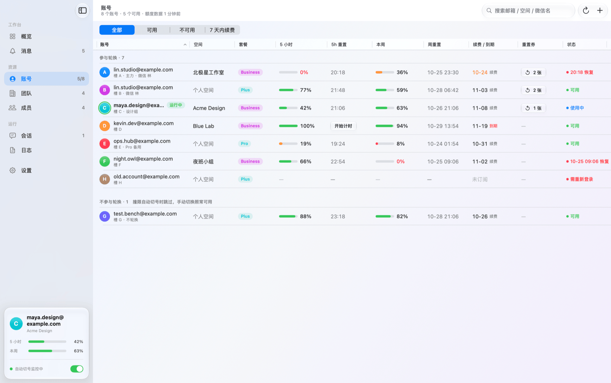
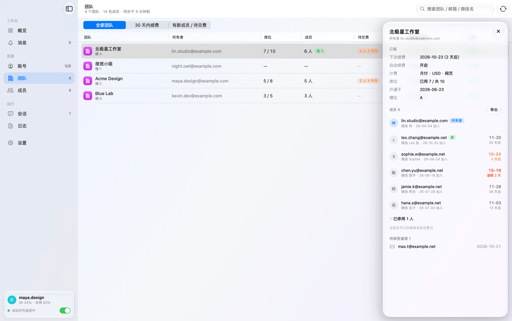
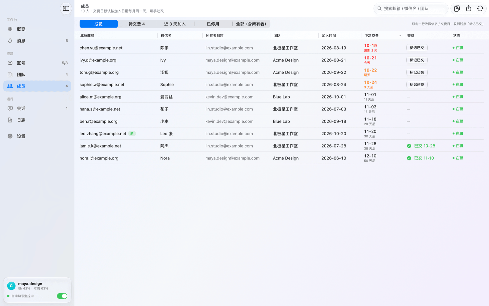
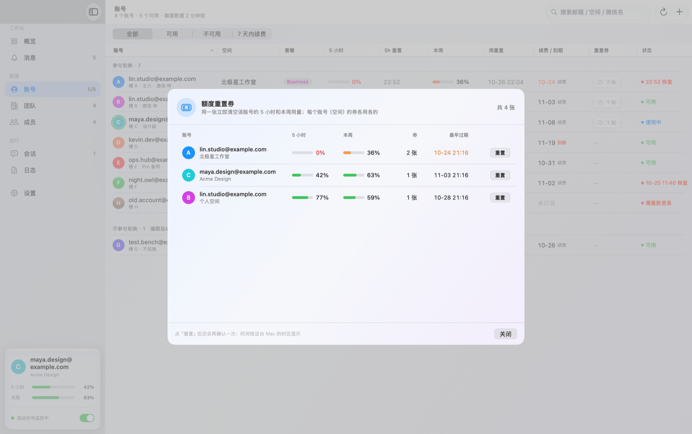
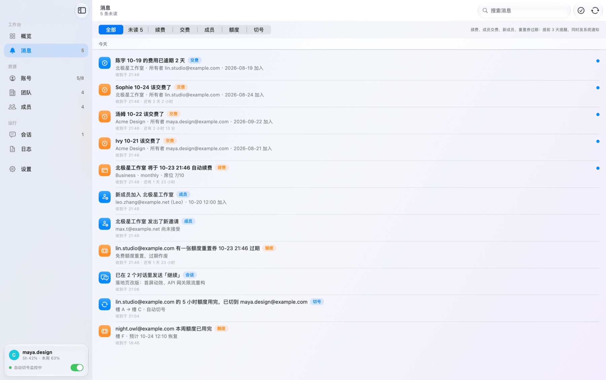
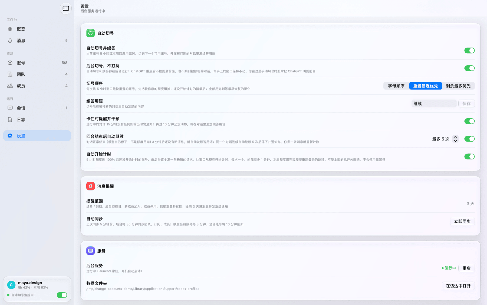
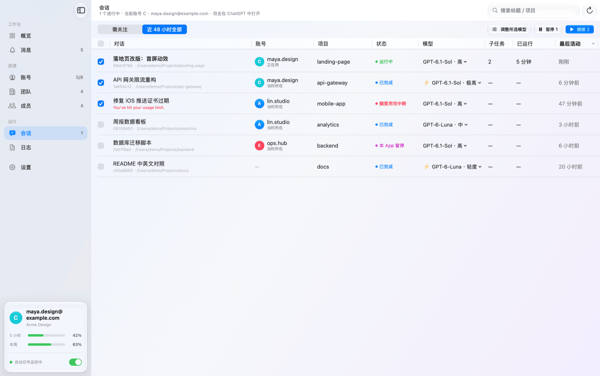
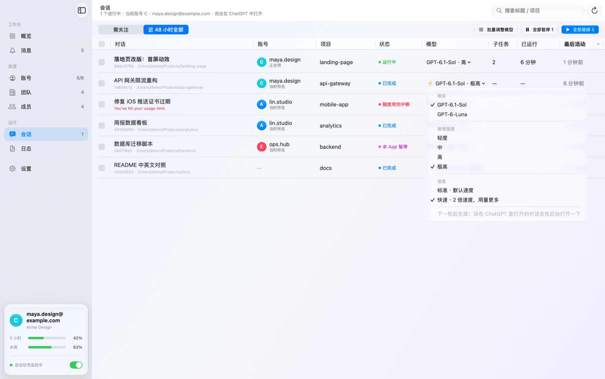
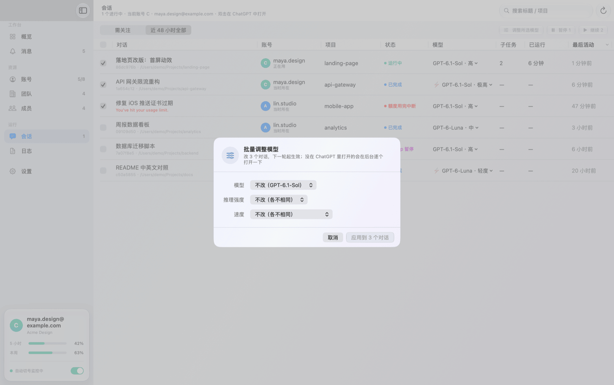

<div align="center">


# ChatGPT / Codex Auto Switch

**Run several ChatGPT / Codex accounts from one window.**<br>
When one account hits its usage limit, switch to the next one automatically and pick the interrupted conversation back up.<br>
Continue or pause every Codex conversation from one table, and change model, reasoning effort and speed on the fly.<br>
Team renewals, member payments and limit-reset credits all in one place.

[](#requirements)
[](#requirements)
[](App)
[](engine.py)
[](LICENSE)

[**⬇ Download**](../../releases/latest) · [Features](#features) · [Sessions](#sessions) · [Install](#install) · [FAQ](#faq) · [中文](README.md)

<picture>
  <source media="(prefers-color-scheme: dark)" srcset="docs/images/overview-dark.png">
  
</picture>

</div>

> [!NOTE]
> This is an independent third-party tool. **It is not made by, affiliated with, or endorsed by OpenAI.**
> It relies on internal endpoints used by the ChatGPT desktop app, which may change at any time. Rotating
> several accounts may violate OpenAI's terms of use — use it at your own risk.
>
> The UI is in Simplified Chinese. All accounts, emails and team names in the screenshots are fake demo data (`scripts/demo.sh`).

## Why

Codex burns through a 5-hour usage window fast. When it runs out mid-reply you have to quit, log into another
account, reopen the app, find the conversation and type "continue". With many accounts it's also hard to remember
which one still has quota, which team renews soon, and which member owes this month's share.

**ChatGPT Accounts** automates all of that. A background service watches your usage; when an account hits its limit,
it switches to the next available one and sends "continue" in every conversation that was cut off.

## Features

| | |
|---|---|
| 🔄 **Auto-switch & resume** | When the limit is hit, waits for the account's other running conversations to finish their turn, switches to the next usable account and resumes the interrupted ones in the background — without pulling ChatGPT to the front |
| 💬 **Sessions** | Every Codex conversation in one table — running, stuck, stopped at the limit, and on which account; **continue / pause** one or a checked batch, all in the background |
| 🧠 **Model & speed on the fly** | Change **model, reasoning effort (low → extra high) and speed (Standard / Fast 2×)** per conversation or in bulk, from the next turn; same options ChatGPT's own menu shows |
| 🧭 **Switching rules** | Pick the next account alphabetically, soonest reset first, or most remaining; keep an account out of the rotation with "skip rotation" |
| 📊 **Quota at a glance** | 5-hour and weekly remaining quota, reset times and when each exhausted account comes back |
| ▶️ **Keep going** | When the model stops on its own (not a limit), send "continue" automatically — capped per conversation |
| ⏱ **Start the clock** | Start an unused account's 5-hour window now, so it has reset by the time you need it — or let the service do it for every account |
| 🎟 **Reset credits** | Lists free limit-reset credits and their expiry; use one with a confirmation |
| 🏢 **Teams & subscriptions** | Renewal / expiry dates, seat usage, members and pending invites of every team workspace |
| 💰 **Member payments** | Monthly due dates per member, overdue in red, "mark as paid" moves to next month |
| 🔔 **Notifications** | Renewals, expiries, failed payments, dues, new members, expiring credits — 3 days ahead |
| 🛡 **Cloudflare-proof** | When Cloudflare blocks the team / subscription / member endpoints, they're fetched through the app's built-in WebKit instead |
| 🔒 **Local only** | No server, no telemetry. Talks to chatgpt.com and nothing else |

Plus the small things: hover a bar on the overview chart for that account's details; the auto-switch card shows the current
and the next account; right-click an account to switch, refresh, use a reset credit, start the clock, copy, rename or delete;
an inspector with subscription, seats, role, 2FA and credits; the account table splits into "in rotation" and "skipped" groups;
CSV export of members; undo for "paid"; light / dark / system appearance and keep-on-top; and after the service restarts
it catches up on conversations that hit a limit in the last 30 minutes. Conversations paused from the Sessions page are marked
"paused here" and skipped by auto-resume; deactivated workspaces can be removed from the team list; the sidebar card shows the
current account with 5-hour and weekly bars.

<table>
  <tr>
    <td></td>
    <td></td>
  </tr>
  <tr>
    <td></td>
    <td></td>
  </tr>
  <tr>
    <td></td>
    <td></td>
  </tr>
</table>

## Sessions

Every Codex conversation from the last 48 hours in one table, without opening them one by one in ChatGPT: status
(running, possibly stuck, stopped at the limit, paused here, stopped by you, done), account, project, sub-tasks, run time and
last activity, newest first. *Needs attention* keeps only the running, interrupted, paused and queued ones; search by title or project.
Everything below runs in the background — ChatGPT is not brought to the front.

- **Continue / pause** — each row has *Continue* (idle) or *Pause* (running). Pause is the same as ChatGPT's stop button;
  conversations paused here are marked and skipped by auto-resume until you continue them.
- **Check to act in bulk** — tick rows (the header box selects all); the header buttons continue, pause or adjust the model of the
  checked conversations, or of the whole list when nothing is checked. About to run out? *Pause all*, switch, *Continue all*.
- **Model, reasoning effort and speed on the fly** — the Model column shows model · effort (⚡ for Fast). Click it for the same menu
  ChatGPT has: model, effort (low / medium / high / extra high…), speed (*Standard · default speed* / *Fast · 2× speed, uses more*),
  current values ticked. Drop easy work to low + Fast, bump a hard one to extra high, without hunting for it in ChatGPT.
- **Bulk adjust** — change model, effort and speed of all checked conversations at once; each can be left "unchanged" so every
  conversation keeps its own value.

Changes apply from the next turn; a conversation that isn't open in ChatGPT is opened in the background briefly and focus is handed back.



<table>
  <tr>
    <td width="50%"></td>
    <td width="50%"></td>
  </tr>
  <tr>
    <td align="center">Click the Model column: model, effort, speed</td>
    <td align="center">Bulk adjust: leave any of them unchanged</td>
  </tr>
</table>

## Requirements

- macOS 14 Sonoma or later on Apple silicon (M1 or newer). macOS 26 gets the Liquid Glass look; 14 and 15 use the standard system style with identical features
- The [ChatGPT desktop app](https://chatgpt.com/download) (with Codex) in `/Applications`
- The system `/usr/bin/python3` (macOS offers to install the Command Line Tools on first launch if needed)

## Install

**Download:** grab `ChatGPT-Accounts-x.y.zip` from [Releases](../../releases/latest), unzip, and drag the app into Applications.
The build is not notarized, so on first launch open *System Settings → Privacy & Security* and click *Open Anyway*, or run:

```bash
xattr -dr com.apple.quarantine "/Applications/ChatGPT 账号.app"
```

**Build from source** (needs the Command Line Tools):

```bash
git clone https://github.com/autoswitch-accounts/chatgpt-codex-auto-switch.git && cd chatgpt-codex-auto-switch
```

```bash
./build.sh
```

**Just look around** with fake data — no network, never touches your accounts:

```bash
scripts/demo.sh
```

## First run

1. Click **＋** to add an account. A clean ChatGPT window opens; log in and pick the workspace, and the credentials are
   captured into a slot (A, B, C…). Every account / team workspace gets its own slot. Adding quits ChatGPT first,
   so do it when nothing is running.
2. The background service installs itself (starts at login) and handles watching quota, switching and resuming.
3. Click *Sync* once to pull teams, subscriptions and members; after that it syncs every 30 minutes.

## FAQ

<details>
<summary><b>Why does ChatGPT restart when switching?</b></summary>

The desktop app is signed into one account at a time. A switch saves the current credentials, quits ChatGPT, swaps in the
target account's credentials and its own browser profile, and reopens it. Automatic switches happen in the background by
default: ChatGPT doesn't jump to the front or to the resumed conversation. Turn off *quiet switching* in Settings to watch it.
</details>

<details>
<summary><b>Why does adding an account quit ChatGPT?</b></summary>

The app's web session lives in each slot's browser profile, while Codex's credentials live in `~/.codex/auth.json`; the two
must belong to the same account. Logging in needs a clean window on the new slot's profile, and only one ChatGPT runs at a time,
so running conversations are interrupted. Add accounts when nothing is running.
</details>

<details>
<summary><b>What does "Start the clock" do? Does it use quota?</b></summary>

The 5-hour window only starts when an account is first used. Starting it early sends one tiny request (almost no quota), so the
window is already close to resetting when you need the account. The service can do this for every account automatically.
</details>

<details>
<summary><b>Does it upload my account data anywhere?</b></summary>

No. Credentials, quota cache and the payment ledger stay in `~/Library/Application Support/codex-profiles/`.
The app only talks to `chatgpt.com` and `auth.openai.com`.
</details>

<details>
<summary><b>Will it spend my reset credits automatically?</b></summary>

Never. A reset credit is only used when you click *Reset* and confirm.
</details>

<details>
<summary><b>How do I uninstall?</b></summary>

```bash
launchctl bootout gui/$(id -u)/com.local.chatgpt.autoswitch
```

```bash
rm -f ~/Library/LaunchAgents/com.local.chatgpt.autoswitch.plist
```

Then delete the app, and optionally `~/Library/Application Support/codex-profiles/` (it contains your login tokens).
</details>

## How it works

- **UI** (`App/`, SwiftUI) never touches the network; it gets JSON from `engine.py`.
- **Engine** (`engine.py`) manages slots, switching, token refresh, quota, the team directory and the payment ledger.
- **Background service** (`autoswitch.py`, launchd) reads the conversation events Codex writes locally, confirms a limit
  online before switching, then sends the resume prompt through the ChatGPT app's local IPC bus.

## License

[MIT](LICENSE)
