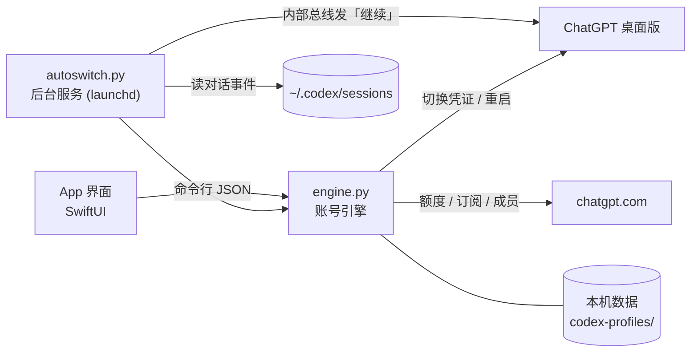

<div align="center">


# ChatGPT / Codex Auto Switch

**ChatGPT 账号**：macOS 上的 ChatGPT / Codex 多账号管理工具。<br>
额度用完时自动切换到下一个可用账号，并在被中断的对话中续答；集中管理 Codex 对话的继续、暂停、模型和速度；<br>
汇总团队订阅、成员交费和额度重置券。界面支持中文和英文。

[](#系统要求)
[](#系统要求)
[](App)
[](engine.py)
[](LICENSE)

[**⬇ 下载最新版**](../../releases/latest) · [功能](#功能一览) · [会话管理](#会话管理) · [安装](#安装) · [常见问题](#常见问题) · [English](README.en.md)

<picture>
  <source media="(prefers-color-scheme: dark)" srcset="docs/images/overview-dark.png">
  
</picture>

</div>

> [!NOTE]
> 本项目为个人开发的第三方工具，**不是 OpenAI 官方产品**，与 OpenAI 无关。
> 项目使用 ChatGPT 桌面版的内部接口，这些接口可能随时变更；多账号轮换可能不符合 OpenAI 的使用条款，风险请自行评估。

> 截图中的账号、邮箱和团队名称均为演示数据，由 `scripts/demo.sh` 生成。

## 概述

使用 Codex 时，单个账号的 5 小时额度用完后，回复会中断，需要手动退出 ChatGPT、切换账号、重新打开并在原对话中发送「继续」。
账号较多时，各账号的剩余额度、团队续费日和成员交费情况也需要单独记录。

本工具在后台监控额度，额度用完时切换到下一个可用账号，并在被中断的对话中自动续答；同时集中展示各账号的额度、团队订阅和成员交费信息。

## 功能一览

| 功能 | 说明 |
|---|---|
| **自动切号与续答** | 额度用完后，先等待同一账号上仍在运行的对话结束，再切换到下一个可用账号，并在后台续答被中断的对话；切换过程不占用前台窗口 |
| **会话管理** | 列出所有 Codex 对话的状态（运行中、疑似卡住、额度用完中断）和所在账号；支持单个或批量继续、暂停，操作在后台完成 |
| **模型与速度** | 为单个或多个对话设置模型、推理强度（轻度至极高）和速度（标准 / 快速），下一轮生效；选项与 ChatGPT 菜单一致 |
| **切号顺序** | 按字母顺序、重置时间最近优先或剩余额度最多优先选择下一个账号；可将指定账号排除在自动轮换之外 |
| **额度监控** | 显示每个账号的 5 小时和本周剩余额度及重置时间；当前账号的数据接近实时 |
| **回合结束后自动继续** | 模型主动结束回合（非额度原因）后自动发送续答用语，每个对话有次数上限 |
| **开始计时** | 使未使用账号的 5 小时窗口从当前时刻开始计时；可由后台服务逐个自动执行 |
| **额度重置券** | 按账号（空间）列出免费重置券及过期时间，使用前需确认 |
| **团队与订阅** | 汇总所有团队空间的续费 / 到期日、席位用量、成员和待接受的邀请 |
| **成员交费台账** | 按成员加入日期每月提醒交费，逾期标红；标记已交后顺延一个周期 |
| **中文 / English** | 在设置中切换界面语言，App 自动重启；历史消息和日志按当前语言显示 |
| **消息中心** | 续费、到期、欠费、交费、新成员、重置券过期等事件提前 3 天提醒，并发送系统通知 |
| **Cloudflare 拦截处理** | 团队、订阅、成员接口被 Cloudflare 拦截时，改由 App 内置的 WebKit 发送请求 |
| **本地存储** | 不使用任何服务器，不收集任何数据 |

## 功能详解

### 概览

概览页显示可用账号数、当前账号的 5 小时剩余额度、团队数量、7 天内续费、待交费和重置券，点击卡片进入对应页面。
额度图中每个账号对应两根柱（5 小时 / 本周），悬停时显示该账号的空间、剩余额度和重置时间。
自动切号卡片显示**当前账号**和**下一个**将切换到的账号，以及两者的额度和重置时间。
侧栏底部显示当前账号的邮箱、所在空间、5 小时和本周剩余额度，以及自动切号开关。

### 自动切号与续答

后台服务（launchd）读取 Codex 写在本机的对话事件。检测到额度用完后，先联网确认，再按设定的顺序
（字母顺序、重置时间最近优先、剩余额度最多优先）切换到下一个可用账号，重启 ChatGPT，并在被中断的对话中发送续答用语（默认「继续」）。
所有账号的额度都用完时，等待到最早恢复的时刻再切换。

**等待运行中的对话。** 额度用完后，服务端通常仍允许当前这一轮完成。因此一个对话撞限后，后台服务会等待同一账号上
其他运行中的对话结束（完成或同样撞限），再退出 ChatGPT 并切换账号。15 分钟无输出的轮次视为卡住，不再等待；最长等待 60 分钟。
等待期间撞限的对话会被记录，切换后一并续答。

**后台续答。** 切换后，续答用语写入 ChatGPT 的待发队列，并在后台唤醒对话，无需打开对话或切换到 ChatGPT。
上一轮被中断的对话（ChatGPT 会暂停其待发队列）改为在后台打开后发送。

「重置时间最近优先」优先选择 5 小时窗口最早重置的账号，以便在剩余额度失效前用完。

需要保留手动使用的账号，可在账号详情或右键菜单中开启「不参与自动轮换」，撞限时会跳过该账号。

切号默认在后台进行（设置项「后台切号，不打扰」）：ChatGPT 重启后不切到前台，也不跳转到被续答的对话。
在本 App 中手动切号或双击会话打开时，ChatGPT 会切到前台。

对话 15 分钟无输出时发送提醒；再过 10 分钟仍无输出，在该轮中追加一句「继续」。

模型有时会输出进度总结后主动结束回合。开启「回合结束后自动继续」后，回合结束 3 分钟内没有新消息即发送「继续」；
同一对话连续自动继续达到上限（默认 5 次）后停止并发送通知，用户发送新消息后重新计数。

开启「自动开始计时」后，后台服务会向 5 小时窗口尚未开始的账号逐个发送一条极短的请求，使各账号的窗口错开开始；
与「重置时间最近优先」配合，可依次用完即将重置的额度。

后台服务重启后，会检查最近 30 分钟内因额度用完而中断的对话，并按需切换账号或续答。

### 会话管理

会话页列出所有 Codex 对话，显示运行状态、所在账号、模型和速度，并可直接操作。所有操作在后台完成，不会将 ChatGPT 切到前台。

- **列表**：显示近 48 小时的对话。状态包括运行中、疑似卡住、额度用完中断、本 App 暂停、已手动停止和已完成；
  另列出账号、项目、子任务数、已运行时长和最后活动时间，默认按最后活动时间倒序。「需关注」仅显示运行中、已中断、已暂停和排队中的对话。
  支持按标题或项目搜索。
- **继续 / 暂停**：未运行的对话显示「继续」按钮，运行中的对话显示「暂停」按钮。暂停等同于在 ChatGPT 中点击停止；
  在此暂停的对话标记为「本 App 暂停」，自动续答会跳过这些对话。
- **批量操作**：勾选行首复选框，或在表头全选；表头按钮对所选对话执行「继续 N」「暂停 N」「调整所选模型」，
  未勾选时作用于列表中的全部对话（按钮显示为「全部继续」「全部暂停」「批量调整模型」）。
- **模型、推理强度和速度**：「模型」列显示当前模型和推理强度（快速档带 ⚡），点击后弹出与 ChatGPT 相同的菜单：
  模型、推理强度（轻度 / 中 / 高 / 极高等）、速度（标准 / 快速，快速消耗更多额度），当前值带勾选标记。
- **批量调整模型**：一次修改所选对话的模型、推理强度和速度；每项均可选「不改」，保留各对话原有的设置。

模型和速度的修改从下一轮开始生效，不影响正在运行的一轮；未在 ChatGPT 中打开过的对话会先在后台打开再修改。
双击一行在 ChatGPT 中打开；右键菜单提供后台继续、暂停、打开对话并发送「继续」、复制对话 ID。


<table>
  <tr>
    <td width="50%"></td>
    <td width="50%"></td>
  </tr>
  <tr>
    <td align="center">「模型」列菜单</td>
    <td align="center">批量调整模型</td>
  </tr>
</table>

### 账号与额度

每个账号（每个团队空间单独计为一个账号）占一行，显示所在空间、套餐、5 小时和本周剩余额度、各自的重置时间和续费日。
当前账号带绿色标记和「运行中」标签。双击一行切换账号（有对话运行时可选择「切换并续答」）；5 小时窗口尚未开始的账号显示「开始计时」按钮。
右键菜单提供刷新额度、使用重置券、开始计时、复制邮箱、重命名和删除。选中一行后，右侧显示详情：订阅状态、席位、优惠、
在空间中的角色、两步验证、地区、同一邮箱的其他槽位和各张重置券。支持按「可用 / 不可用 / 7 天内续费」筛选，
以及按邮箱、空间、微信名或槽位字母搜索。

状态列显示账号当前是否可用：可用、使用中、「16:14 恢复」（额度已用满，到时自动恢复）、
「空间无额度」（额度未用满，但团队空间的 credits 已用完，需空间所有者处理）、需重新登录。
存在「不参与自动轮换」的账号时，表格分为「参与轮换」和「不参与轮换」两组。


<details>
<summary><b>额度重置券</b>（截图）</summary>


</details>

### 团队与订阅

汇总已添加账号可访问的所有团队空间：下次续费 / 到期日、计费方式、席位用量、成员及加入时间、待接受的邀请。
已关闭自动续费的空间标记为「到期」，3 天内需续费的空间会出现在消息中心。近 3 天加入的成员带「新」标记，每个团队的成员可单独导出 CSV。
已停用的空间可点击「移除」从列表中隐藏（仅影响本机显示，可在右上角「已移除」中恢复）。


### 成员交费台账

为团队成员记录微信名和交费日。默认按加入日期每月同一天收费，也可手动设置。
交费日到期后不会自动顺延：点击「标记已交」后才进入下一个周期，未标记则显示红色的「逾期 N 天」。
误操作可通过右键菜单「撤销上一次已交标记」撤销。交费日可在日历中修改，也可恢复为按加入日期推算。支持复制全部邮箱和导出 CSV。


<details>
<summary><b>编辑成员</b>（截图）</summary>


</details>

### 消息中心与日志

续费、到期、欠费、成员交费、新成员加入、成员停用、新邀请和重置券过期等事件提前 3 天提醒；切号、等待、续答等后台事件也会记录。
消息支持按类别筛选、搜索和全部标为已读。
日志页按时间合并显示后台服务和手动操作的记录，可只显示要点，也可在访达中打开日志文件。

<table>
  <tr>
    <td></td>
    <td></td>
  </tr>
</table>

### 设置

自动切号总开关、后台切号、切号顺序、续答用语、卡住时干预、回合结束后自动继续（含次数上限）、自动开始计时；
外观（跟随系统 / 浅色 / 深色）、窗口置顶、语言（跟随系统 / 中文 / English）、立即同步、重启后台服务、打开数据文件夹。

**语言。** 切换语言后 App 自动重启。界面以及后台服务此后写入的日志、通知和状态均使用新语言；
此前以另一种语言写入的消息、日志，以及同步得到的团队优惠等文字，也按当前语言显示（无法识别的保持原文）。
续答用语为默认值时，会随语言在「继续」和「Continue」之间切换；自定义的续答用语保持不变。


## 系统要求

- macOS 14（Sonoma）或更高版本，Apple 芯片（M1 及以后）。macOS 26 上使用 Liquid Glass 界面，macOS 14 / 15 上使用系统原有样式，功能相同
- 「应用程序」中已安装 [ChatGPT 桌面版](https://chatgpt.com/download)（含 Codex）
- 系统自带的 `/usr/bin/python3`。未安装 Xcode 命令行工具时，首次打开会提示安装

## 安装

### 下载安装包（推荐）

1. 从 [Releases](../../releases/latest) 下载 `ChatGPT-Accounts-x.y.zip`，解压后将「ChatGPT 账号」拖入「应用程序」。
2. 安装包未经苹果公证，首次打开会提示「无法验证开发者」。在「系统设置 → 隐私与安全性」页面下方点击「仍要打开」，
   或在终端执行：

```bash
xattr -dr com.apple.quarantine "/Applications/ChatGPT 账号.app"
```

### 从源码编译

需要 Xcode 命令行工具（`xcode-select --install`）。本机编译的 App 不受公证限制。

```bash
git clone https://github.com/autoswitch-accounts/chatgpt-codex-auto-switch.git && cd chatgpt-codex-auto-switch
```

```bash
./build.sh
```

`./build.sh` 编译到 `build/`，安装到 `/Applications` 并启动后台服务。仅编译不安装：`./build.sh --no-install`。

### 演示模式

使用演示数据打开 App，不联网，不读取真实账号，也不操作 ChatGPT：

```bash
scripts/demo.sh
```

英文界面（演示数据同为英文）：

```bash
scripts/demo.sh -AppleLanguages '(en)'
```

## 快速开始

1. 打开 App，点击右上角 **＋** 添加账号。App 会打开一个独立的 ChatGPT 窗口，登录并选择空间后自动保存凭证。
   每个账号（团队空间）占一个槽位（A、B、C…），槽位顺序即默认的切号顺序。
   添加账号前会退出 ChatGPT，建议在没有对话运行时添加（原因见[常见问题](#常见问题)）。
2. 后台服务会自动安装并开机启动，负责监控额度、自动切号和续答，可在「设置」中关闭。
3. 点击「同步」获取团队、订阅和成员信息，之后后台每 30 分钟同步一次。

## 常见问题

<details>
<summary><b>账号信息会上传到其他地方吗？</b></summary>

不会。本项目不使用服务器，也没有统计或埋点。所有数据（各账号的登录凭证、额度缓存、台账）仅保存在本机
`~/Library/Application Support/codex-profiles/`。App 只与 `chatgpt.com` 和 `auth.openai.com` 通信，全部代码均在本仓库中。
</details>

<details>
<summary><b>切号时 ChatGPT 为什么会重启？</b></summary>

ChatGPT 桌面版同一时间只能登录一个账号。切号流程为：保存当前凭证 → 退出 ChatGPT → 换入目标账号的凭证和独立的浏览器资料目录 → 重新打开。
每个槽位使用独立的资料目录，网页登录状态互不影响。

自动切号时 ChatGPT 默认在后台重启，不会切到前台，也不会跳转到被续答的对话。如需在前台切换，可在设置中关闭「后台切号，不打扰」。
在本 App 中手动切号或双击会话时，ChatGPT 会切到前台。
</details>

<details>
<summary><b>添加账号时为什么要退出 ChatGPT？</b></summary>

ChatGPT 的登录状态分为两部分：网页登录状态保存在各槽位的资料目录中，Codex 凭证保存在 `~/.codex/auth.json`，两者必须对应同一账号。
添加账号时需要用新槽位的资料目录打开一个干净的窗口登录，而 ChatGPT 同一时间只能运行一个实例，运行中的对话也依赖当前凭证，
因此需要先退出。运行中的对话会被中断，建议在没有任务时添加。

添加账号只清除本机的登录信息，不会注销原来的账号，已保存的账号无需重新登录。
</details>

<details>
<summary><b>状态显示「空间无额度」是什么意思？</b></summary>

团队空间的账号额度用完后，服务端还会返回空间的 credits 能否用于超额使用。5 小时或本周额度已用满时，
状态显示「几点恢复」，到时自动恢复；额度未用满、但因空间 credits 用完而无法使用时，显示「空间无额度」，
需等待空间所有者充值或调整，自动切号会跳过该账号。
</details>

<details>
<summary><b>「开始计时」有什么作用？会消耗额度吗？</b></summary>

5 小时额度是滚动窗口，从账号首次使用时开始计时。「开始计时」用该账号发送一条极短的请求（消耗可忽略），使窗口从当前时刻开始；
之后实际使用该账号时，窗口可能已接近重置。
开启「自动开始计时」后，后台服务会在各账号的窗口重置后自动执行（每次一个，间隔至少 1 分钟；本周额度已用完或需要重新登录的账号除外）。
</details>

<details>
<summary><b>撞限后为什么没有立即切号？</b></summary>

切号需要退出 ChatGPT，同一账号上运行中的对话会被中断，之后也较难在后台续答。
额度用完后，服务端通常仍允许当前这一轮完成，因此后台服务会等待这些对话结束后再切换（卡住 15 分钟的不再等待，最长等待 60 分钟）。
日志中会记录「还有 N 个对话在跑，等它们都自己停下再切号」。

等待期间如果当前账号恢复可用（例如使用了重置券），则不切换账号，直接在当前账号上续答。
此时在会话页点击「继续」或「全部继续」会先检查当前账号：可用则立即续答；仍不可用则发送通知，说明这些对话已排在队列最前。
</details>

<details>
<summary><b>在会话页修改模型或暂停，与在 ChatGPT 中操作有区别吗？</b></summary>

没有区别。修改模型、推理强度和速度使用的是 ChatGPT 自身修改设置的接口，从下一轮开始生效，不影响正在运行的一轮；暂停等同于点击停止。
对话未在 ChatGPT 窗口中打开过时，会先在后台打开再修改（窗口可能短暂出现，焦点随即恢复）。
推理强度只列出 ChatGPT 菜单中显示的选项；Max 在 ChatGPT 设置中默认关闭，此处也不列出。
</details>

<details>
<summary><b>重置券会被自动使用吗？</b></summary>

不会。重置券仅在手动点击「重置」并确认后使用，后台服务不会使用重置券。
</details>

<details>
<summary><b>同一邮箱在两个团队空间中，重置券是否通用？</b></summary>

不通用。重置券属于账号（空间）：同一邮箱在两个空间中的重置券相互独立、ID 不同，使用一张只重置对应空间的额度。
因此账号页和重置券列表按槽位分别显示。
</details>

<details>
<summary><b>支持哪些系统？是否支持 Intel Mac？</b></summary>

支持 macOS 14 Sonoma 及以上版本、Apple 芯片（M1 及以后）。所有 M 系列 Mac 均可升级到 macOS 14 或更高版本。
macOS 13 及更早版本缺少界面所需的部分 SwiftUI 接口；Intel Mac 未经测试，安装包仅包含 Apple 芯片版本。
</details>

<details>
<summary><b>如何卸载？</b></summary>

停止并删除后台服务：

```bash
launchctl bootout gui/$(id -u)/com.local.chatgpt.autoswitch
```

```bash
rm -f ~/Library/LaunchAgents/com.local.chatgpt.autoswitch.plist
```

然后将「应用程序」中的 App 移到废纸篓。如需同时删除数据，再删除 `~/Library/Application Support/codex-profiles/`（其中包含各账号的登录凭证）。
</details>

## 工作原理



- **界面**（`App/`）不直接联网，所有数据通过调用 `engine.py` 的命令行以 JSON 获取。
- **账号引擎**（`engine.py`）负责槽位、切号、凭证刷新、额度查询、团队目录同步、成员台账和后台服务安装。
- **后台服务**（`autoswitch.py`）读取 Codex 写在本机的对话事件，仅依据结构化的撞限字段判断，切号前联网确认；
  切换后通过 ChatGPT 的本机内部总线在原对话中发送续答用语。

<details>
<summary><b>使用的接口</b></summary>

请求使用各账号自己的 token，请求头为 `User-Agent: codex_cli_rs`。

| 接口 | 用途 |
|------|--------|
| `wham/usage` | 5 小时 / 本周剩余额度、重置时间、是否撞限 |
| `wham/rate-limit-reset-credits` | 免费额度重置券及过期时间；`/consume` 用于使用一张 |
| `codex/responses` | 「开始计时」：发送一条极短的请求 |
| `me` | 姓名、注册时间、两步验证、地区 |
| `accounts/check/v4-2023-04-27` | 可访问的全部空间；套餐、续费 / 到期 / 取消时间、计费周期 |
| `subscriptions?account_id=` | 席位用量、是否自动续费（仅查询团队空间） |
| `accounts/{id}/users` · `invites` | 成员（含加入时间、停用时间）、待接受的邀请 |

`accounts/*` 和 `subscriptions` 对非浏览器客户端可能返回 Cloudflare 验证页。此时引擎改由 App 在隐藏的 WebKit 页面中
使用同一账号的 token 发送请求（`ChatGPTAccounts --web-fetch`，不登录网页，不保存凭证）；仍然失败的项沿用上次同步的结果，不会被空数据覆盖。

会话页的继续、暂停和修改模型使用 ChatGPT 的本机接口：续答写入 `~/.codex` 中的待发队列，再通过 `codex://` 链接唤醒；
暂停和修改设置通过 ChatGPT 的本机内部总线（ChatGPT 各窗口之间同步对话所用的通道）。
</details>

<details>
<summary><b>本机数据文件</b>（<code>~/Library/Application Support/codex-profiles/</code>）</summary>

| 文件 | 内容 |
|------|------|
| `A.json` … `Z.json` | 各账号的凭证快照（文件名为槽位字母，即切号顺序） |
| `names.json` / `lastused.json` | 自定义显示名 / 上次切离时间 |
| `quota.json` | 各账号的额度缓存 |
| `autoswitch.json` | 自动切号开关 `enabled`、续答用语 `prompt`、停滞提醒 `stall_nudge`、切号顺序 `order`（`alpha` / `soon` / `most`）、自动开始计时 `auto_start`、回合结束后自动继续 `auto_continue` 及次数上限 `continue_max`、后台切号 `quiet_switch`、不参与轮换的槽位 `skip`、界面语言 `lang`（`zh` / `en`） |
| `directory.json` | 账号目录：邮箱；各槽位（空间）的重置券 `slotCredits`；空间的订阅、席位、成员、邀请 |
| `meta.json` | 台账：`wechat`（邮箱 → 微信名）、`pay`（手动设置的交费日）、`paid`（已交至哪一期）、`since`（开始记账的日期） |
| `notices.json` | 消息中心（最多 500 条，含已读状态） |
| `switch_history.json` | 切号记录（时间和槽位），用于确定对话所在的账号 |
| `daemon_state.json` | 后台服务状态：等待的恢复时间、续答队列、待执行的暂停 / 设置修改、会话页暂停的对话（重启后保留） |
| `models.json` | 可选模型列表缓存（有效期一天） |
| `hidden_teams.json` | 团队页中移除的空间 |
| `autoswitch.log` / `manager.log` | 后台服务日志 / 手动操作日志 |
</details>

<details>
<summary><b>命令行</b></summary>

`engine.py` 的每条命令输出一行 JSON，可供脚本调用：

```bash
python3 "/Applications/ChatGPT 账号.app/Contents/Resources/engine.py" --list-json
```

```bash
python3 "/Applications/ChatGPT 账号.app/Contents/Resources/engine.py" --refresh-usage
```

```bash
python3 "/Applications/ChatGPT 账号.app/Contents/Resources/engine.py" --directory-json --refresh
```

```bash
tail -f ~/Library/Application\ Support/codex-profiles/autoswitch.log
```

完整的命令列表见 `engine.py` 文件开头的注释。
</details>

## 项目结构

```text
App/                  界面（SwiftUI + Liquid Glass）：概览 / 消息 / 账号 / 团队 / 成员 / 会话 / 日志 / 设置
App/en.lproj/         英文译文（以中文原文为键）；Python 部分的译文在 engine.py / autoswitch.py 的 EN 表中
engine.py             账号引擎（App 和后台服务共用）
autoswitch.py         后台服务：撞限 → 切号 / 等待 → 续答
Assets/               App 图标（由 make_icon.swift 生成 appicon.icns）
build.sh              从源码构建 App；默认无身份签名，可通过 SIGN_IDENTITY 或 signing.local 指定证书
scripts/package.sh    生成发布用的 zip（无身份签名；签名中含开发者信息时终止打包）
scripts/demo.sh       使用演示数据打开 App（用于演示和截图）
scripts/i18n_check.py 检查英文界面是否有未翻译或未本地化的文字
.github/workflows/    推送 v* 标签时由 GitHub Actions 编译、打包并发布
```

## 参与

欢迎提交 Issue 和 Pull Request。

## 许可证

[MIT](LICENSE)
