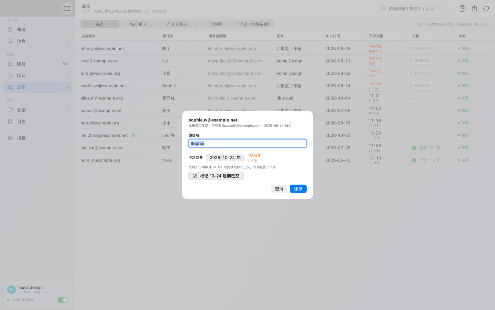
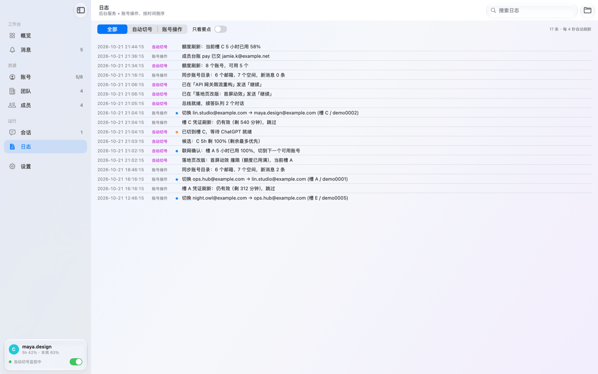
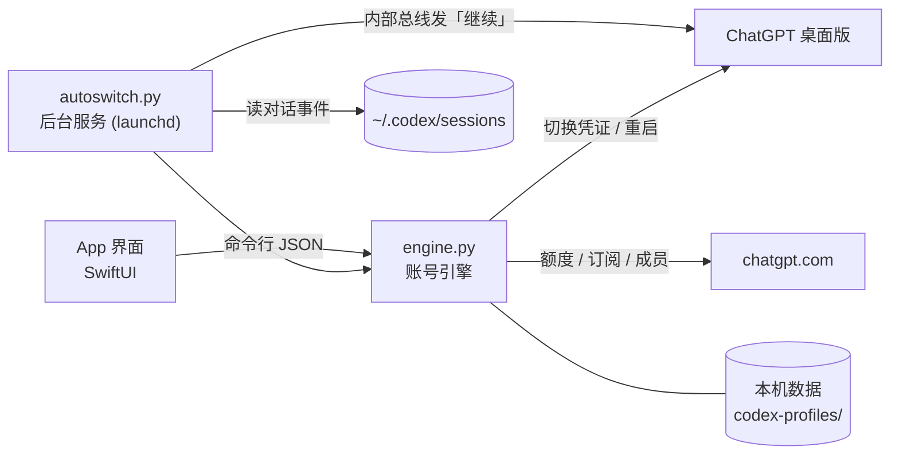

<div align="center">


# ChatGPT / Codex Auto Switch

**ChatGPT 账号：多个 ChatGPT / Codex 账号，一个窗口管好。**<br>
额度用完自动换号，被打断的对话自动接着答；所有 Codex 对话一张表里继续 / 暂停，随手换模型、推理强度和速度；<br>
团队续费、成员交费、额度重置券一目了然。

[](#系统要求)
[](#系统要求)
[](App)
[](engine.py)
[](LICENSE)

[**⬇ 下载最新版**](../../releases/latest) · [功能](#功能一览) · [会话管理](#-会话管理) · [安装](#安装) · [常见问题](#常见问题) · [English](README.en.md)

<picture>
  <source media="(prefers-color-scheme: dark)" srcset="docs/images/overview-dark.png">
  
</picture>

</div>

> [!NOTE]
> 本项目是个人开发的第三方工具，**不是 OpenAI 官方产品**，与 OpenAI 没有任何关系。
> 用到的是 ChatGPT 桌面版自己使用的内部接口，随时可能失效；多账号轮换可能不符合 OpenAI 的使用条款，请自行判断风险。

> 截图里的账号、邮箱、团队名都是演示用的假数据（`scripts/demo.sh` 生成）。

## 为什么做这个

用 Codex 写代码时，一个账号的 5 小时额度很快就见底：回复写到一半停住，得手动退出、换号、重新打开、
找到原来的对话、再说一句「继续」。账号一多，哪个还有额度、哪个团队快续费、哪位成员该交钱，全靠记忆。

**ChatGPT 账号** 把这些都自动化了：它在后台盯着额度，用完就换到下一个可用账号，并回到被打断的对话里替你说「继续」。

## 功能一览

| | |
|---|---|
| 🔄 **自动切号并续答** | 额度用完先等同账号上还在跑的对话自己做完，再换到下一个可用账号，被打断的对话在后台自动接着答；全程不抢你手上的窗口 |
| 💬 **会话管理** | 所有 Codex 对话一张表：在跑、卡住、因额度中断、跑在哪个账号；逐个或勾选批量**继续 / 暂停**，全在后台，不用切到 ChatGPT |
| 🧠 **随手换模型和速度** | 每个对话单独或批量改**模型、推理强度（轻度 → 极高）、速度（标准 / 快速 2 倍）**，下一轮生效；选项和叫法跟 ChatGPT 自己的菜单一致 |
| 🧭 **切号规则可调** | 按字母、「重置最近优先」或「剩余最多优先」挑下一个；留着自己手动用的账号可以设成「不参与自动轮换」 |
| 📊 **额度一眼看清** | 每个账号的 5 小时 / 本周剩余、重置时间、几点恢复，当前账号几乎实时 |
| ▶️ **结束后自动继续** | 模型自己停下（不是额度用完）也能自动接着干，每个对话有次数上限，整晚不用守着 |
| ⏱ **开始计时** | 没用过的账号点一下，5 小时窗口从现在开始计时，用到时已经快重置；也可以交给后台自动挨个起算 |
| 🎟 **额度重置券** | 列出每个账号的免费重置券和过期时间，一键使用，用前二次确认 |
| 🏢 **团队与订阅** | 所有团队空间的续费 / 到期日、席位用量、成员、待接受邀请 |
| 💰 **成员交费台账** | 按加入日每月提醒交费，逾期标红，收到钱点「标记已交」顺延一个月 |
| 🔔 **消息中心** | 续费、到期、欠费、交费、新成员、券过期，提前 3 天提醒并发系统通知 |
| 🛡 **不怕 Cloudflare 拦截** | 团队、订阅、成员接口被 Cloudflare 拦下时，自动改用 App 内置的浏览器内核去取 |
| 🔒 **数据只在本机** | 没有服务器，不收集任何信息；只和 chatgpt.com 通信 |

## 功能详解

### 📈 概览

一页看全：可用账号数、当前 5 小时剩余、团队、7 天内续费、待交费、重置券，点卡片直达对应页面。
额度图上每个账号两根柱（5 小时 / 本周），鼠标悬停浮出这个账号的空间、剩余和重置时间；
右边的自动切号卡片写着**当前账号**和**下一个**会切到的账号，各自的额度和重置时间都在。
侧栏底部常驻当前账号的卡片：完整邮箱、所在空间、5 小时和本周剩余的进度条，以及自动切号开关。

### 🔄 自动切号并续答

后台服务（launchd 常驻）读 Codex 写在本机的对话事件。一旦发现撞限，先联网确认，再按你选的顺序
（字母轮转、「重置最近优先」或「剩余最多优先」）切到下一个可用账号，重启 ChatGPT 后在被打断的对话里发一句续答用语（默认「继续」）。
所有账号都用完时，它会睡到最早恢复的那一刻，到点自动切回。

**不打断还在干活的对话。** 额度到了，服务端往往还会让正在跑的那一轮做完。所以一个对话撞限后，
后台会先等同一个账号上其他还在跑的对话都自己停下（做完或也撞限），再退出 ChatGPT 切号；
15 分钟没任何动静的轮次算卡住，不再等它，最多等 60 分钟。等待期间撞限的对话都会记下来，切号后一起续上。

**续答在后台进行。** 切号后，续答用语直接排进 ChatGPT 自己的待发队列，再在后台唤醒对话，几秒内就接着跑，
不用打开对话、也不切到 ChatGPT；上一轮被打断过的对话（ChatGPT 会暂停它的队列）改为在后台打开对话发送。

「重置最近优先」会先挑 5 小时窗口最快重置的账号：它剩下的额度马上要作废，先用掉最划算。

不想被自动切过去的账号（比如留着自己手动用的），在账号详情或右键菜单里打开「不参与自动轮换」，撞限时就会跳过它。

切号默认在后台进行（设置里的「后台切号，不打扰」）：ChatGPT 重启后不抢到最前面，也不跳到被续答的对话，你手上的窗口保持不动；
在本 App 里手动切号、双击会话打开时，照常把 ChatGPT 叫到前台。

对话卡住 15 分钟没动静也会提醒；再过 10 分钟还不动，就在那一轮里补一句「继续」。

模型有时会自己写一段进度总结就停下（并不是额度用完）。打开「回合结束后自动继续」后，回合结束 3 分钟内你没接手，
它就替你发「继续」；同一个对话连续自动继续到上限（默认 5 次）就停下并通知你，你发一条消息就重新计数。

打开「自动开始计时」后，5 小时额度还没开始计时的账号会被后台逐个发一句极短的请求，让窗口从现在开始走，
各账号错开起算，配合「重置最近优先」可以一个接一个用掉快到期的额度。

后台服务重启后，会补查最近 30 分钟内因额度停下的对话，该切号就切、该续答就续答。

### 💬 会话管理

所有 Codex 对话在一张表里：不用在 ChatGPT 里一个个点开，就知道哪些在跑、哪些卡住、哪些因额度中断，
跑在哪个账号、用的什么模型和速度，并且直接在这里操作，全部在后台进行，ChatGPT 不会被叫到前台。

- **一眼看全**：近 48 小时的对话，状态分运行中、疑似卡住、额度用完中断、本 App 暂停、已手动停止、已完成；
  另有账号、项目、子任务数、已运行时长、最后活动，默认按最后活动倒序。「需关注」只留在跑、中断、暂停和排队的；可按标题或项目搜索。
- **继续 / 暂停**：每行右边有「继续」（没在跑的）或「暂停」（正在跑的）按钮。
  暂停等同在 ChatGPT 里点停止，之后点「继续」就接着做；在这里暂停的对话标成「本 App 暂停」，自动续答会跳过它。
- **勾选批量操作**：行首勾选，表头的框全选；表头按钮对勾选的对话「继续 N」「暂停 N」「调整所选模型」，没勾就是列表里全部。
  比如额度快到了，一键「全部暂停」；换好账号再「全部继续」。
- **随手换模型、推理强度和速度**：「模型」列显示当前的模型 · 推理强度（快速档带 ⚡），点开就是和 ChatGPT 一样的菜单：
  模型、推理强度（轻度 / 中 / 高 / 极高…）、速度（「标准 · 默认速度」/「快速 · 2 倍速度，用量更多」），当前值打勾。
  简单的活换成轻度 + 快速省时间，卡住的难题临时调到极高，不用切过去一个个找。
- **批量调整模型**：勾几个对话（不勾就是全部），一次改模型、推理强度、速度；每项都可以选「不改」，保留各自原来的值。

改模型和速度从下一轮开始生效，正在跑的这一轮不变；没在 ChatGPT 里打开过的对话会在后台打开一下，焦点马上还给你。
双击一行在 ChatGPT 里打开；右键可以后台继续、暂停、打开对话并发「继续」、复制对话 ID。


<table>
  <tr>
    <td width="50%"></td>
    <td width="50%"></td>
  </tr>
  <tr>
    <td align="center">点开「模型」列：模型、推理强度、速度</td>
    <td align="center">批量调整：每项可选「不改」</td>
  </tr>
</table>

### 📊 账号与额度

每个账号（每个团队空间单独算一个）一行：所在空间、套餐、5 小时和本周剩余、各自的重置时间、续费日。
当前正在用的账号有绿色圈和「运行中」标记。双击一行切换（有对话在跑时可以选「切换并续答」）；没开始计时的账号会出现「开始计时」按钮。
右键还能刷新额度、用重置券、开始计时、复制邮箱、重命名、删除。选中一行，右侧浮出详情：订阅状态、席位、优惠、
你在空间里的角色、两步验证、地区、同邮箱的其他槽位、每张重置券。可以按「可用 / 不可用 / 7 天内续费」筛选，
按邮箱、空间、微信名或槽位字母搜索。

状态列写着每个账号现在能不能用：可用、使用中、「16:14 恢复」（额度用满，到点自动恢复）、
「空间无额度」（额度没满，但团队空间的 credits 用完了，要等空间所有者处理）、需重新登录。
有账号设成「不参与自动轮换」时，表格分成「参与轮换」和「不参与轮换」两组，一眼就能看出哪些会被自动切到。


<details>
<summary><b>额度重置券</b>（点开看截图）</summary>


</details>

### 🏢 团队与订阅

自动汇总你能进的全部团队空间：下次续费 / 到期日、计费方式、席位已用 / 总数、成员及加入时间、待接受的邀请。
关闭了自动续费的空间会标「到期」，3 天内要续费的会进消息中心。近 3 天的新成员带「新」标记，每个团队的成员可以单独导出 CSV。
已停用的空间可以点「移除」从列表里拿掉（只改本机显示，右上角「已移除」里能恢复）。


### 💰 成员交费台账

给团队成员记微信名和交费日。默认按加入日期每月同一天收费，也可以手动改。
到了日子不会自己顺延：收到钱后点「标记已交」才跳到下个月；过期没标记就一直显示红色「逾期 N 天」。
点错了右键「撤销上一次已交标记」。交费日可以在日历里改，也能恢复按加入日推算。支持一键复制全部邮箱、导出 CSV。


<details>
<summary><b>编辑成员</b>（点开看截图）</summary>



</details>

### 🔔 消息中心与日志

续费、到期、欠费、成员交费、新成员加入、成员停用、新邀请、重置券过期，都提前 3 天提醒；
切号、等待、续答等后台事件也会记下来。消息可以按类别筛选、搜索、全部已读。
日志页按时间合并显示后台服务和手动操作的每一步，可以只看要点，或在访达中打开日志文件。

<table>
  <tr>
    <td></td>
    <td></td>
  </tr>
</table>

### ⚙️ 设置

自动切号总开关、后台切号（不打扰）、切号顺序、续答用语、卡住时干预、回合结束后自动继续（含次数上限）、自动开始计时；
外观（跟随系统 / 浅色 / 深色）、窗口置顶、立即同步、重启后台服务、打开数据文件夹。


## 系统要求

- macOS 14（Sonoma）或更高，Apple 芯片（M1 及以后）。在 macOS 26 上是 Liquid Glass 界面，14 / 15 上是系统原有样式，功能完全一样
- 已安装 [ChatGPT 桌面版](https://chatgpt.com/download)（带 Codex），放在「应用程序」里
- 系统自带的 `/usr/bin/python3`。没装过 Xcode 命令行工具的话，第一次打开会弹窗让你装，点「安装」即可

## 安装

### 方式一：下载安装包（推荐）

1. 到 [Releases](../../releases/latest) 下载 `ChatGPT-Accounts-x.y.zip`，解压后把「ChatGPT 账号」拖进「应用程序」。
2. 安装包没有做苹果公证，第一次双击会提示「无法验证开发者」。打开「系统设置 → 隐私与安全性」，
   在页面下方点「仍要打开」即可，之后就能正常打开。也可以在终端执行：

```bash
xattr -dr com.apple.quarantine "/Applications/ChatGPT 账号.app"
```

### 方式二：从源码编译

需要 Xcode 命令行工具（免费，`xcode-select --install`）。自己编译的 App 不会被拦。

```bash
git clone https://github.com/autoswitch-accounts/chatgpt-codex-auto-switch.git && cd chatgpt-codex-auto-switch
```

```bash
./build.sh
```

会编译到 `build/`、装进 `/Applications` 并启动后台服务。只编译不安装：`./build.sh --no-install`。

### 先看看界面（演示模式）

不想先登录自己的账号？用一份假数据打开 App，不联网、不碰你的账号和 ChatGPT：

```bash
scripts/demo.sh
```

## 第一次使用

1. 打开 App，点右上角 **＋** 添加账号：它会打开一个干净的 ChatGPT 窗口，你在里面登录、选好空间，凭证自动收进来。
   每个账号 / 每个团队空间占一个槽位（A、B、C…），也就是默认的切号顺序。
   添加时会先退出 ChatGPT，最好挑没有对话在跑的时候加（原因见[常见问题](#常见问题)）。
2. 后台服务会自动装好（开机自启），负责盯额度、自动切号和续答。不需要的话在「设置」里关掉。
3. 点「同步」拉一遍团队、订阅和成员；之后后台每 30 分钟同步一次。

## 常见问题

<details>
<summary><b>会把我的账号信息上传到哪里吗？</b></summary>

不会。没有任何服务器，也没有统计或埋点。所有数据（各账号的登录凭证、额度缓存、台账）都只存在本机
`~/Library/Application Support/codex-profiles/`。App 只和 `chatgpt.com`、`auth.openai.com` 通信，代码全部在这个仓库里，可以自己检查。
</details>

<details>
<summary><b>切号时 ChatGPT 为什么会重启？</b></summary>

ChatGPT 桌面版一次只能登录一个账号。切号就是：保存当前凭证 → 退出 ChatGPT → 换上目标账号的凭证和独立的浏览器资料 → 重新打开。
每个槽位有自己的资料目录，网页登录状态不会串号。

自动切号时 ChatGPT 默认在后台重启：不会抢到最前面，也不会跳到被续答的对话，你正在用的窗口保持不动。
想看着它切，可以在设置里关掉「后台切号，不打扰」。在本 App 里手动切号、双击会话时，照常把 ChatGPT 叫到前台。
</details>

<details>
<summary><b>添加账号时为什么要退出 ChatGPT？</b></summary>

ChatGPT 的登录分两半：网页登录状态存在每个槽位自己的资料目录里，Codex 的凭证存在 `~/.codex/auth.json`，两者必须是同一个账号。
添加时要用新槽位的资料目录开一个干净窗口让你登录，而 ChatGPT 一次只开一个、正在跑的对话也在用同一份凭证，
所以得先退出。正在跑的对话会被打断，建议挑没有任务的时候添加。
</details>

<details>
<summary><b>状态写「空间无额度」是什么意思？</b></summary>

团队空间的账号额度用完后，服务端还会告诉你「空间没有 credits 可以超额续用」。只要 5 小时或本周额度是满的，
状态照样显示「几点恢复」，到点自动恢复；只有额度没满、却因为空间 credits 用完而用不了时，才显示「空间无额度」，
这种情况要等空间所有者充值或调整，自动切号会先跳过它。
</details>

<details>
<summary><b>「开始计时」有什么用？会消耗额度吗？</b></summary>

5 小时额度是滚动窗口，从这个账号第一次使用时才开始计时。提前点一下，用该账号发一句极短的请求（几乎不耗额度），
窗口就从现在开始走；等你真正用到它时，可能已经快重置了。
设置里打开「自动开始计时」，后台会在每个账号的窗口重置后自动替你点（每次一个、间隔至少 1 分钟，本周额度用完或需要重新登录的跳过）。
</details>

<details>
<summary><b>撞限后为什么没有马上切号？</b></summary>

切号要退出 ChatGPT，同一账号上还在跑的对话会被打断，被打断的对话之后也更难在后台续上。
而额度到了，服务端往往还会让正在跑的那一轮做完，所以后台会等它们都自己停下再切（卡住 15 分钟的不等，最多等 60 分钟）。
日志里会写「还有 N 个对话在跑，等它们都自己停下再切号」。
</details>

<details>
<summary><b>在会话页改模型、暂停，和在 ChatGPT 里操作一样吗？</b></summary>

一样。改模型 / 推理强度 / 速度用的是 ChatGPT 自己改设置的那条路，从下一轮开始生效，正在跑的这一轮不变；
暂停等同点停止。对话没在 ChatGPT 的窗口里打开过时，会在后台打开一下再改（窗口可能闪一下，焦点会还回去）。
推理强度只列 ChatGPT 菜单里显示的那些：Max 在 ChatGPT 设置里默认关着，这里也不列。
</details>

<details>
<summary><b>重置券会被自动用掉吗？</b></summary>

不会。重置券只在你手动点「重置」并再次确认后才会使用，后台服务从不动用重置券。
</details>

<details>
<summary><b>支持哪些系统？Intel Mac 能用吗？</b></summary>

macOS 14 Sonoma 及以后、Apple 芯片（M1 及以后）。所有 M 系列 Mac 都能免费升级到 macOS 14 以上。
macOS 13 及更早的系统缺少界面用到的一些 SwiftUI 接口；Intel Mac 没有测试过，安装包也只包含 Apple 芯片版本。
</details>

<details>
<summary><b>怎么卸载？</b></summary>

先停掉并删除后台服务：

```bash
launchctl bootout gui/$(id -u)/com.local.chatgpt.autoswitch
```

```bash
rm -f ~/Library/LaunchAgents/com.local.chatgpt.autoswitch.plist
```

再把「应用程序」里的 App 拖进废纸篓。不想留数据就再删掉 `~/Library/Application Support/codex-profiles/`（里面有各账号的登录凭证）。
</details>

## 工作原理



- **界面**（`App/`）本身不联网，所有数据都通过调用 `engine.py` 的命令行拿 JSON。
- **账号引擎**（`engine.py`）管槽位、切号、凭证刷新、查额度、同步团队目录、成员台账、安装后台服务。
- **后台服务**（`autoswitch.py`）读 Codex 写在本机的对话事件：只认结构化的撞限字段，切号前一律联网确认，
  切完通过 ChatGPT 的本机内部总线在原对话里发续答用语。

<details>
<summary><b>用到的接口</b></summary>

请求头 `User-Agent: codex_cli_rs`，用各账号自己的 token。

| 接口 | 拿到的 |
|------|--------|
| `wham/usage` | 5 小时 / 本周剩余、重置时间、是否撞限 |
| `wham/rate-limit-reset-credits` | 免费额度重置券及过期时间；`/consume` 使用一张 |
| `codex/responses` | 「开始计时」：发一句极短的请求 |
| `me` | 姓名、注册时间、两步验证、地区 |
| `accounts/check/v4-2023-04-27` | 能进的全部空间；套餐、续费 / 到期 / 取消时间、计费周期 |
| `subscriptions?account_id=` | 席位已用 / 总数、是否自动续费（只查团队空间） |
| `accounts/{id}/users` · `invites` | 成员（含加入时间、停用时间）、待接受的邀请 |

`accounts/*`、`subscriptions` 会被 Cloudflare 对非浏览器客户端拦下（返回验证页）。被拦时，引擎改由 App 在不显示的
WebKit 页面里用同一个账号的 token 发请求（`ChatGPTAccounts --web-fetch`，不登录网页、不存任何凭证）；
某项仍失败就沿用上次同步的结果，不会拿空数据覆盖。

会话页的继续、暂停、改模型走 ChatGPT 的本机接口：续答排进 `~/.codex` 里的待发队列再用 `codex://` 链接唤醒；
暂停和改设置通过 ChatGPT 的本机内部总线（和 ChatGPT 自己的窗口之间同步对话用的那条）。
</details>

<details>
<summary><b>本机数据文件</b>（<code>~/Library/Application Support/codex-profiles/</code>）</summary>

| 文件 | 内容 |
|------|------|
| `A.json` … `Z.json` | 各账号的凭证快照（文件名就是槽位字母，也是切号顺序） |
| `names.json` / `lastused.json` | 自定义显示名 / 上次切走时间 |
| `quota.json` | 各账号额度缓存 |
| `autoswitch.json` | 自动切号开关 `enabled`、续答用语 `prompt`、停滞提醒 `stall_nudge`、切号顺序 `order`（`alpha` / `soon` / `most`）、自动开始计时 `auto_start`、结束后自动继续 `auto_continue` 和次数上限 `continue_max`、后台切号 `quiet_switch`、不参与轮换的槽位 `skip` |
| `directory.json` | 账号目录：邮箱、重置券；空间的订阅、席位、成员、邀请 |
| `meta.json` | 台账：`wechat`（邮箱 → 微信名）、`pay`（手动交费日）、`paid`（已交到哪一期）、`since`（开始记账的日子） |
| `notices.json` | 消息中心（最多 500 条，带已读状态） |
| `switch_history.json` | 每次切号的时间和槽位，用来标出对话跑在哪个账号 |
| `daemon_state.json` | 后台服务状态：等待的恢复时刻、续答队列、待办的暂停 / 改设置、会话页暂停过的对话（重启不丢） |
| `models.json` | 可选模型列表缓存（一天） |
| `hidden_teams.json` | 团队页里移除的空间 |
| `autoswitch.log` / `manager.log` | 后台服务日志 / 手动操作日志 |
</details>

<details>
<summary><b>命令行</b></summary>

`engine.py` 每条命令输出一行 JSON，可以自己写脚本调用：

```bash
python3 "/Applications/ChatGPT 账号.app/Contents/Resources/engine.py" --list-json
```

```bash
python3 "/Applications/ChatGPT 账号.app/Contents/Resources/engine.py" --refresh-usage
```

```bash
python3 "/Applications/ChatGPT 账号.app/Contents/Resources/engine.py" --directory-json --refresh
```

```bash
tail -f ~/Library/Application\ Support/codex-profiles/autoswitch.log
```

全部命令见 `engine.py` 开头的说明。
</details>

## 项目结构

```text
App/                 界面（SwiftUI + Liquid Glass）：概览 / 消息 / 账号 / 团队 / 成员 / 会话 / 日志 / 设置
engine.py            账号引擎（App 和后台服务共用）
autoswitch.py        后台服务：撞限 → 切号 / 等待 → 续答
Assets/              App 图标（make_icon.swift 生成 appicon.icns）
build.sh             从源码生成 App；默认无身份签名，可用 SIGN_IDENTITY 或 signing.local 换成自己的证书
scripts/package.sh   打发布用的 zip（无身份签名，签名里带开发者信息就拒绝打包）
scripts/demo.sh      用假数据打开 App（演示 / 截图）
.github/workflows/   推送 v* 标签时由 GitHub 自动编译、打包并发布
```

## 参与

欢迎提 Issue 和 Pull Request。改界面后可以用 `scripts/demo.sh --page <页面>` 直接打开对应页面检查效果。

## 许可证

[MIT](LICENSE)
